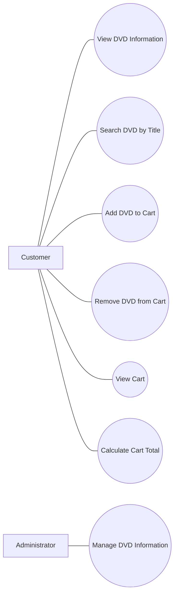

# AIMS – Use Case Description

## 1. Actors

- **Customer**: Người dùng mua và tìm kiếm DVD
- **Administrator**: Người quản lý hệ thống và thông tin DVD

## 2. Use Cases

### Customer
- View DVD Information
- Search DVD by Title
- Add DVD to Cart
- Remove DVD from Cart
- View Cart
- Calculate Cart Total

### Administrator
- Manage DVD Information

## 3. Use Case Diagram

